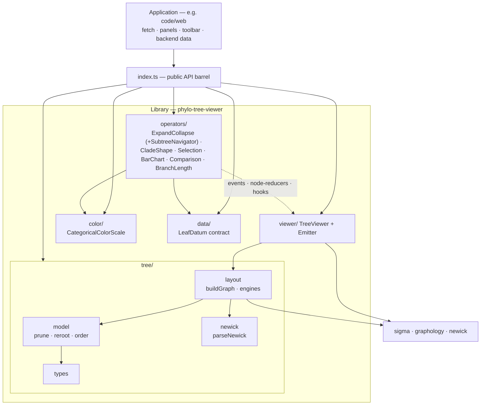
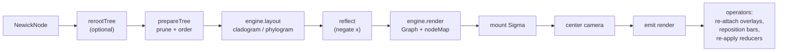
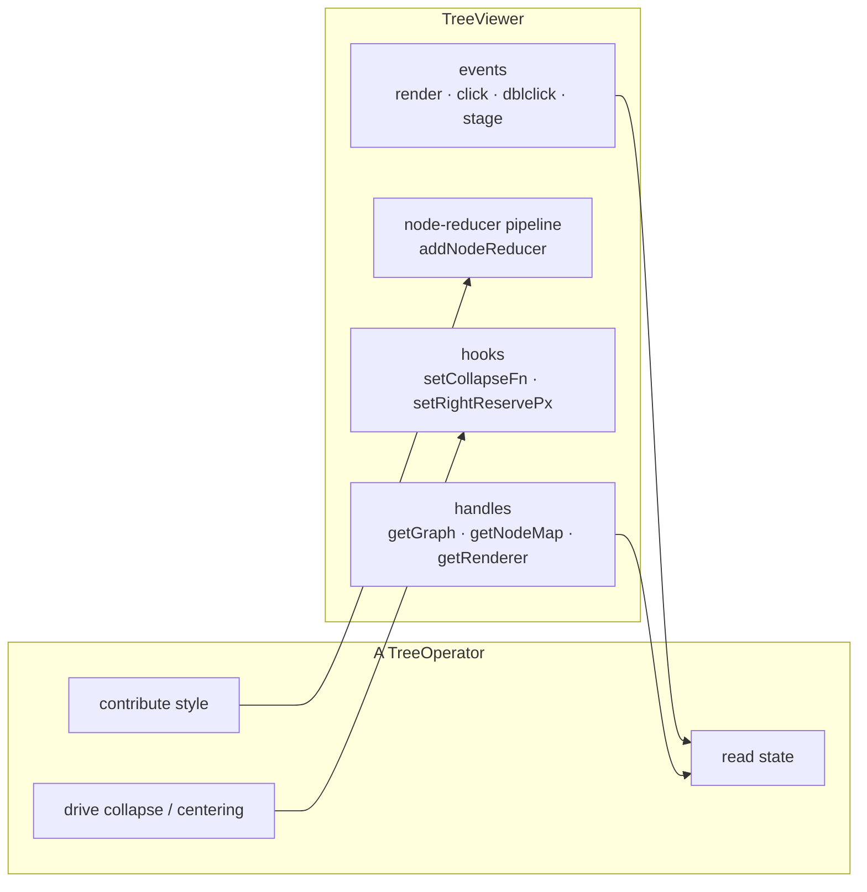

# Phylogenetic Tree Visualization Library

A framework-agnostic TypeScript library for rendering and interacting with
phylogenetic trees, built on [Sigma.js](https://www.sigmajs.org/) (WebGL graph
rendering) and [graphology](https://graphology.github.io/) (graph data model).
It is designed to be reused across projects: the application feeds it a tree as
plain data and attaches the interactions it needs.

> **Maintenance note (for the author):** this file is the single source of
> truth for what the library does. It must be updated whenever the library
> changes — new modules, options, operators, events, data contracts, or
> behavioural changes. Treat it as part of the implementation, not an
> afterthought.

---

## 1. Purpose & scope

The library renders a single phylogenetic tree per **viewer** instance as a
rectangular dendrogram (cladogram or phylogram), and supports a composable set
of **operators** for interaction (collapse/expand, selection, per-leaf bar
charts). Multiple viewers are fully independent, so two trees can be shown side
by side and compared (including one reflected to face the other).

Input is a plain `NewickNode` object (the shape produced by parsing Newick, but
equally a JSON object a backend could send directly). The library performs **no
network I/O** — fetching/loading is the application's responsibility. This keeps
the library project-agnostic and is the key boundary that makes it reusable.

---

## 2. Design principles

Moved to **[DECISIONS.md §28](../../docs/DECISIONS.md)** in the repository's `docs/`, with the rest of the
project's design record. Two copies of an argument drift; this file keeps the module map and the
API surface, which belong beside the code they describe.

---

## 3. Architecture & module map

```
phylo-tree-viewer/src/
  index.ts                  Public API barrel — the only import surface consumers use.
  presentation/             Everything that renders or reacts to a tree.
    tree/
      types.ts              Core types: NewickNode, LayoutMode, IsCollapsed, ChildOrder.
      model.ts              Pure tree ops: metrics, traversal, re-rooting, pruning, ordering.
      newick.ts             parseNewick — forest-aware Newick string → NewickNode.
      navigation.ts         leafNamesOf / mrcaId — selection → tree structure.
      layout.ts             buildGraph + LayoutEngine registry (cladogram/phylogram).
    viewer/
      tree_viewer.ts        TreeViewer — the Sigma-backed renderer host.
      emitter.ts            Tiny typed event emitter.
    color/
      color_scale.ts        Categorical (shared category colors) + Sequential (value→color) scales.
    data/
      leaf_data.ts          Backend-driven per-leaf data contract (LeafDatum etc.).
      comparison.ts         Comparison data contract + node keyers (keyByClade/keyByName).
    operators/
      operator.ts           TreeOperator interface (attach/detach contract).
      expand_collapse.ts    ExpandCollapseOperator — collapse/expand; incremental & subtree modes.
      subtree_navigator.ts  SubtreeNavigator — drill-in stack behind subtree mode (not an operator).
      clade_shape.ts        CladeShapePresenter — collapsed clades as leaf-scaled wedges.
      selection.ts          SelectionOperator — click + drag-box selection.
      barchart_presenter.ts BarChartPresenter — per-leaf stacked composition bars.
      comparison.ts         ComparisonOperator — branch/node difference coloring + navigation.
      branch_lengths.ts     BranchLengthPresenter — each branch's length written beside it.
    export/
      snapshot.ts           snapshotViewer — a PNG of a panel, canvases plus DOM overlays.
      report.ts             Report model + renderReport (a self-contained HTML document).
      comparison_report.ts  buildComparisonReport / downloadComparisonReport (HTML, PNG, PDF).
      raster.ts             HTML → canvas → PNG/PDF, so the three formats share one layout.
  performance/              Keeping large trees affordable. No tree/Sigma/API knowledge.
    cache_entry.ts          CacheEntry<T> — intrusive LRU entry + tier ("warm" | "rendered").
    double_linked_list.ts   DoubleLinkedList<T> — intrusive DLL (O(1) move-to-front / evict-tail).
    cache_manager.ts        CacheManager<T> — generic byte-budgeted LRU with a two-queue tier system.
  config/
    config.ts               Config-driven bootstrap: Config type + createViewer/createComparison.
  config.example.jsonc      Example (general) config file (JSONC — fields annotated with allowed values); ships as the config schema-by-example.
```

The two top-level layers are the architectural split: `presentation/` decides
what a tree *looks like* and how it responds; `performance/` decides what stays
in memory. `index.ts` and `config/` sit above both because they span them.

**Status:** the `performance/` layer is exported separately, as
`phylo-tree-viewer/performance`. The web app (`code/web/src/api/sliceCache.ts`) uses
`CacheManager` to keep recently fetched slices; the fetching itself stays in the
app, which keeps the library's "never fetch" boundary (§2).

### 3.1 Layering & dependencies

The dependency arrow points one way: `application → lib`, and within the lib,
operators/viewer depend on the tree/color/data layers, never the reverse.



### 3.2 Build & render pipeline

What happens on `setTree(...)` or any config change (`rerender()`):



### 3.3 Operator ↔ viewer channels

Operators never touch each other; they coordinate only through the viewer's
three public channels, which is what keeps them independent and composable.



---

## 4. Core data model (`tree/types.ts`)

```ts
interface NewickNode {
  name: string;
  length?: number;          // branch length (to parent)
  branchset?: NewickNode[]; // children; absent/empty ⇒ leaf
  category?: string;        // optional identifier for bar charts; defaults to name
  metadata?: Record<string, string | number | null>; // per-leaf fields for filtering (§8.2)
  collapsed?: boolean;      // set by prepareTree when a clade was truncated as collapsed
  origin?: NewickNode;      // set by prepareTree: back-ref to the original (un-pruned) node
}

type LayoutMode = "phylogram" | "cladogram";

type IsCollapsed = (node: NewickNode) => boolean;   // collapse predicate
const NEVER_COLLAPSED: IsCollapsed;                 // default: nothing collapsed

type ChildOrder = (a: NewickNode, b: NewickNode) => number;  // sibling comparator
```

- **Leaf identifier** (used to bind bar-chart data and colors) is
  `node.category ?? node.name`.
- **`metadata`** carries arbitrary backend-supplied fields on a leaf (sampling
  date, source, host, …). The library never fetches or interprets them — the
  full isolate store stays on the backend; only the fields relevant to the
  current subtree ride along on its leaves, where the metadata filter (§8.2)
  can test them.
- `IsCollapsed` is a predicate, not a set, so the collapse operator can key
  state however it likes (it uses stable structural IDs — see §9.1).
- `ChildOrder` defines the vertical order of sibling clades. Reordering siblings
  is a *branch rotation*: structurally legal, never changes topology.

---

## 5. Tree model operations (`tree/model.ts`)

Pure, side-effect-free functions over `NewickNode`. Independent of Sigma/DOM.

**Metrics & traversal**
- `maxRootDist(node)` — maximum root-to-leaf distance (sum of branch lengths).
- `maxDepth(node)` — maximum depth in edges (root = 0).
- `subtreeSize(node)` / `countLeaves(node)` — number of leaves under a node.
- `getSubtreeLeaves(node)` — all leaf nodes under (or equal to) a node.

**Re-rooting**
- `rerootTree(tree, targetName)` — returns a **new** tree re-rooted on the edge
  leading to the named node; splits that edge's length evenly between the two
  new branches. Returns `null` if the name is absent or already the root. Does
  not mutate the input.

**Pruning + ordering**
- `prepareTree(node, isCollapsed, leafBudget, order?)` — the core pre-layout
  transform. Two independent concerns:
  - **Selection** (which clades survive `leafBudget`): always favours larger
    subtrees, so the displayed subset stays representative. `leafBudget` is a
    leaf-count budget, split among siblings. This is density pruning, not a
    structural change.
  - **Ordering** (vertical order of survivors): the modular `order` comparator,
    default `orderByName`. A structure-preserving branch rotation.
  - Also collapses degree-1 chains (merging branch lengths) so depth reflects
    real branching, and marks collapsed clades as terminal nodes.
  - Stamps each output node with an `origin` back-reference to the original node
    it was cloned from, so operators keyed on the original tree (e.g. the
    Expandor/Collapsor, §9.1) can map a displayed node back to its source.
- `orderByName` *(default)* — ascending lexicographic ladderize. Orders siblings
  by a representative string key: the node's own name if it is *informative*
  (contains an alphanumeric — e.g. a goeBURST ST id), otherwise the
  lexicographically smallest leaf name in its subtree. Placeholder internal-node
  names (our NJ/UPGMA exports mark unnamed internals as `_`) are treated as
  absent, so ordering falls through to the leaves rather than keying every
  internal node on the same `_`. Comparison uses `localeCompare` with
  `numeric: true`, so it works
  for **any** labels — numeric ids, strain names, or mixed — keeping embedded
  numbers in natural order (`st2` before `st10`) while still sorting non-numeric
  labels lexicographically. This is the safe default because, unlike
  `orderByNumeric`, it never collapses non-numeric names into a single bucket.
- `orderByNumeric` — ascending numeric ladderize. Orders siblings by a
  representative numeric key: the node's own numeric name if present (e.g. a
  goeBURST ST id on an internal clade), otherwise the smallest numeric leaf id
  in its subtree. Non-numeric names sort last (fall back to +Infinity). Prefer
  `orderByName` unless labels are guaranteed numeric.
- `orderBySizeDesc` — largest-subtree-first (the pre-ordering default).

---

## 6. Newick parsing (`tree/newick.ts`)

- `parseNewick(text): NewickNode` — pure (string in, tree out).
- **Forest-aware.** Some inputs (goeBURST output) are a *forest*: many
  `;`-separated components — real trees plus thousands of singleton STs — on one
  line. The underlying parser returns only one tree, so `parseNewick` splits the
  components itself and returns the **largest** one (most leaves), skipping bare
  singletons. Single-tree inputs (NJ/UPGMA) pass through unchanged.

---

## 7. Layout pipeline (`tree/layout.ts`)

Turns a `NewickNode` tree into a renderable graphology `Graph` plus a lookup
from real graph-node IDs to positioned `LayoutNode`s. Knows nothing about Sigma,
interaction, or DOM.

**`buildGraph(tree, isCollapsed?, maxNodes?, layoutMode?, hideInternalNodes?, rerootOn?, reflect?, order?): BuiltGraph`**

Pipeline: optional re-root → `prepareTree` (prune + order) → compute layout via
the selected engine → optional horizontal reflection (negate every node's x) →
render nodes + connector edges into the graph → build the `id → LayoutNode` map.

```ts
interface BuiltGraph { graph: Graph; nodeMap: Map<string, LayoutNode>; }

interface LayoutNode {
  id: string; label: string; x: number; y: number;
  isLeaf: boolean; isCollapsed: boolean; named: boolean;
  children: LayoutNode[]; source: NewickNode;  // the (pruned) source node
}
```

**Layout engines**
- `LayoutEngine` interface: `layout(prepared, ctx)` computes positions;
  `render(graph, root, hideInternalNodes, ctx)` adds nodes/edges.
- `LAYOUT_ENGINES: Record<LayoutMode, LayoutEngine>` — the registry. Add a new
  style by implementing `LayoutEngine` and adding an entry; nothing else
  changes.
- Built-in rectangular engine (`makeRectEngine`):
  - **cladogram** — x from depth (equal spacing per level).
  - **phylogram** — x from cumulative branch length, to scale. Each tip's
    branch stops at its real length; a light leader (`LEADER_COLOR`, flagged
    `leader: true`, no `nodeId`) carries it to the aligned column.
  - **Leaf alignment.** All terminal tips (leaves and collapsed clades) are
    placed at a common x (the right edge of the 0–100 span) so they line up in a
    column and bar charts share a baseline. Internal nodes keep their
    depth/distance x.
  - **Branch-length clamping**, opt-in (`clampBranches: true`). Caps any
    branch at ~8× the median so one very long branch (e.g. an outgroup stem)
    can't dominate the scale. Off by default, because a capped branch is drawn
    at a length the tree does not have.
  - **Connectors.** Horizontal/vertical dendrogram lines are drawn via invisible
    connector nodes (`v_*`, `h_*`), which are excluded from `nodeMap`. Each
    connector edge carries a `nodeId` attribute naming the real node it
    represents (child for a horizontal, parent clade for a vertical fork), so
    operators can style branches even though the endpoints are helper nodes.
  - Vertical bars appear only where a node truly branches (≥2 children).

**Reflection.** `reflect` negates every node's x after layout, before render, so
the whole dendrogram flips (root on the right, tips on the left). Because the
graph coordinates themselves are mirrored, edges, connectors, and Sigma's
coordinate conversion all stay consistent. (Sigma has no built-in
mirror/reflect — its camera only pans, zooms, and rotates.)

> **Extension point.** `LAYOUT_ENGINES` is how a fundamentally different
> representation gets added without touching the pipeline — a **network/MST
> engine for goeBURST** is the concrete case (§16). Positioning lives entirely in
> the engine; what an engine does *not* abstract is the bar presenter and
> right-reserve centering (both assume a left↔right tip column) and the collapse
> model (which assumes a rooted hierarchy), so a non-hierarchical engine needs
> those generalised too.

---

## 8. The viewer (`viewer/tree_viewer.ts`)

`TreeViewer` is the core, interaction-agnostic host. It owns the Sigma renderer,
the graphology graph, the layout state, and a composable node-reducer pipeline.
It does **not** implement collapse, selection, or bar charts — those are
operators that attach to it.

**Construction**
```ts
new TreeViewer(container: HTMLElement, options?: TreeViewerOptions)

interface TreeViewerOptions {
  layoutMode?: LayoutMode;     // default "cladogram"
  lengthScale?: LengthScale;   // phylogram only: "linear" (default) or "log" = log(1 + length)
  clampBranches?: boolean;     // phylogram only: cap branches at ~8x the median, default false
  maxNodes?: number;           // leaf budget, default 200
  hideInternalNodes?: boolean; // default true
  rerootOn?: string;           // outgroup leaf/clade name
  fitPadding?: number;         // zoom-out margin after auto-fit, default 0.3
  reflect?: boolean;           // horizontal mirror, default false
  childOrder?: ChildOrder;     // sibling order, default orderByName
  suppressContextMenu?: boolean; // swallow the native menu in-container, default true
  labelDensity?: number;       // Sigma's label density; defaults leave Sigma's own
  labelGridCellSize?: number;  //   a dendrogram wants a much smaller cell
}
```

**Data / config methods**
- `setTree(tree)` / `getTree()`
- `setLayoutMode(mode)` / `getLayoutMode()`
- `setLengthScale(scale)` / `getLengthScale()`
- `setReflect(reflect)` / `isReflected()`
- `setChildOrder(order)`
- `reroot(name | undefined)`
- `setMaxNodes(n)`
- `setHideInternalNodes(hide)`
- `setCollapseFn(fn | null)` — install the collapse predicate (used by the
  collapse operator).
- `setFilter(predicate)` / `clearFilter()` / `getFilter()` — the metadata filter
  (§8.2).

**Handles for operators**
- `getContainer()`, `getRenderer()`, `getGraph()`, `getNodeMap()`.

**Selection → structure** (turn selected graph-node ids back into tree structure)
- `leavesOf(ids)` — the concrete leaf **names** a selection stands for, unfolding
  any collapsed clade to the hidden isolates it represents (via each node's
  `origin`). The clean input for "fetch/aggregate the selection": pass
  `selection.getSelected()` straight in.
- `mrcaOf(ids)` — the graph id of the most-recent common ancestor of the selected
  nodes (`null` if none known). Feed a leaf selection in and the result straight
  to `expandCollapse.collapseNodes([...])` to fold the clade around it.

  These keep the app from reaching through `getNodeMap().get(id).source` and its
  `origin`/clone internals: keys cross the boundary, structure does not. Backed
  by the pure `leafNamesOf` / `mrcaId` in `tree/navigation.ts`.

**Node- & edge-reducer pipelines**
- `addNodeReducer(reducer): () => void` — register a reducer; returns an
  unregister fn. All reducers are folded (in order) into Sigma's single
  `nodeReducer`, so independent operators contribute styling (selection
  highlight, label hiding, comparison coloring) without clobbering each other.
- `addEdgeReducer(reducer): () => void` — the symmetric pipeline for branches,
  folded into Sigma's `edgeReducer`. Used to color branches by comparison value.
- `applyReducers()` / `applyEdgeReducers()` — re-apply the composed pipelines
  (operators call these after state changes).

**Camera / centering**
- After every (re)mount the viewer centers the tree with a margin (`fitPadding`)
  so labels/bars aren't clipped.
- `setRightReservePx(px)` — operators report how many pixels of content sit on
  the leaf side (labels + bars); the viewer shifts the tree by half that so the
  combined content is centered. The shift direction flips when reflected.

**Rendering**
- `rerender()` — rebuild the graph from current state, kill+remount Sigma, emit
  `render`. Called automatically by the config setters.

> **Sigma container caveat.** `Sigma.kill()` empties the container (removes all
> child nodes) on every rebuild. Operators that add DOM overlays (bar charts,
> selection box) must re-attach them on each `render` event — the built-in
> operators do this.

**Events (`ViewerEvents`)** — subscribe via `viewer.events.on(type, handler)`:
- `render { renderer, graph, nodeMap }` — after every rebuild + remount.
- `treeChanged { tree }` — when `setTree` replaces the tree.
- `clickNode { node }`, `doubleClickNode { node }` (synthesized — Sigma has no
  native dblclick), `clickStage { x, y }`, `enterNode { node }`, `leaveNode {}`,
  `filterChanged { filter }` (§8.2), `destroy {}`.
- `rightClickNode { node, x, y, original }` / `rightClickStage { x, y, original }`
  — the seam an app-drawn **context menu** hangs off. `x`/`y` are viewport
  coordinates for positioning; `original` is the DOM event. Hit-testing is
  Sigma's, i.e. by marker size, so with `hideInternalNodes` the reachable nodes
  are leaves and collapsed clade markers — same as `clickNode`.

  **The native menu is suppressed inside the container** (`suppressContextMenu`,
  default true) so an app-drawn menu isn't covered by the browser's. Note where
  that listener lives: on the **viewer's container**, not on Sigma's right-click
  event. Sigma listens on its own mouse layer, which is a *sibling* of the
  operator overlays — anything opting into pointer events swallows the event
  before Sigma sees it, and the native menu would still pop there. Every overlay
  is click-through today, so this is insurance against the next one that isn't,
  and it also covers container area the mouse layer does not span.
  `destroy()` removes the listener, since the element can outlive the viewer.

  Scoped to the panel: right-clicks on toolbars, headers or a footer keep the
  native menu, and it's per viewer, so one panel can opt out (`false`) to keep
  e.g. "Save image as…". The event is emitted either way.

  Everything else a menu needs already exists — `selection.getSelected()`,
  `expandCollapse.collapseNodes/expandNodes`, `viewer.mrcaOf` / `leavesOf`, and
  `ec.getMode()` to gate incremental-only items.

### 8.2 Metadata filtering

Filter the **currently rendered** leaves by a predicate over their
`NewickNode.metadata` (§4). Intended for the architecture where the large
isolate/metadata store stays on the backend and each subtree response embeds the
relevant fields on its own leaves — the predicate runs against the metadata each
visible leaf already carries, never a full client-side dataset.

```ts
type LeafFilter = (
  metadata: Record<string, string | number | null>,
  leaf: NewickNode,          // also given, for name/category predicates
) => boolean;                // true = keep, false = filter out

viewer.setFilter((m) => m.year != null && Number(m.year) >= 2015);
viewer.clearFilter();
```

- **Presentation-only, no rebuild.** `setFilter`/`clearFilter` re-apply the
  node-reducer pipeline and emit `filterChanged`; they do **not** rebuild or
  re-layout the graph. So a filter only ever affects leaves already on screen —
  it never "unhides" a leaf pruned by the `maxNodes` budget or folded inside a
  collapsed clade. To widen the visible set, change the tree/collapse/budget
  first; the filter then narrows what remains.
- **Effect.** A failing leaf is dimmed (`FILTER_DIM_COLOR`) with its label
  cleared; matching leaves, internal nodes, and connectors are untouched. The
  dim is folded in **after** all operator reducers, so it wins over e.g. a
  selection highlight. Only leaves are ever filtered.
- **`passesFilter(leaf)`** (`true` when no filter is set) is the hook overlay
  operators use to stay consistent with the node dimming. The `BarChartPresenter`
  listens for `filterChanged` and, on rebuild, gives a filtered-out leaf **no
  bar** and excludes it from the `maxTotal` used to scale bar lengths — so the
  composition bars always match the leaves still shown. No aggregate "popover"
  exists in the library: composition is per-leaf, so "respect the filter" means
  the suppressed leaves drop out, not a recomputed cross-leaf tally.
- The app owns the filter *UI* (inputs, chips) and calls `setFilter`; the library
  supplies the mechanism and the metadata carrier only.

`destroy()` tears down the renderer and clears subscriptions.

---

### 8.1 Click, double-click, and Sigma's defaults

Sigma emits **no node-level double-click**: its mouse captor emits a raw
`doubleClick` with coordinates but no node. The viewer therefore *synthesises*
node double-clicks — two `clickNode`s on the same node within
`DOUBLE_CLICK_MS` (350) become `doubleClickNode`, and the second click is not
re-emitted as a single, so operators never see both.

Sigma also **zooms on double-click by default**, right after emitting:

```js
this.emit("doubleClick", mouseCoords);
if (mouseCoords.sigmaDefaultPrevented) return;
// … camera.animate({ ratio: ratio / doubleClickZoomingRatio })
```

Double-clicking a *node* is the library's gesture (expand/collapse, or drill in —
§9.1), so the viewer hooks the captor and calls `preventSigmaDefault()` whenever a
node is hovered; otherwise every toggle would also lurch the camera. Double-click
on empty **stage still zooms**, which is the useful half of the default. Since the
captor's event carries no node, the viewer tracks the hovered node (`enterNode` /
`leaveNode`) to attribute the gesture.

Note the two windows differ — Sigma's `doubleClickTimeout` is 300ms, the viewer's
synthesis window is 350ms — which is harmless: below 300 Sigma would zoom and we
prevent it; between 300–350 we toggle and Sigma never treated it as a double-click
at all; above 350 neither does. There is no gap where Sigma zooms unclaimed.

---

## 9. Operators

`TreeOperator` is the contract: `{ name, attach(viewer), detach() }`. Each
operator is independent; attaching the same set to two viewers gives two
independent panels that both support every operation.

### 9.1 ExpandCollapseOperator (`operators/expand_collapse.ts`)

Collapse/expand on **every** internal node, not only named clades — the
navigation mechanism for the difference-driven drill-down (summarize the tree,
then expand the clades that differ). It assigns a stable structural ID to each
node (path-based: root `r`, i-th child `p.i`) and keys collapse state on those
IDs, so state survives the repeated graph rebuilds caused by layout/prune/hide
changes.

- **A trigger always exists.** Double-click is the operator's own trigger, but
  Sigma hit-tests by marker size and `hideInternalNodes` (§8) draws internal
  nodes at size 0 — so there would be nothing clickable at all. The operator
  installs a node reducer giving every *actionable* clade an invisible hit area
  (`HIT_SIZE`, transparent). Right-click (§8) hit-tests the same way, so this is
  also what lets a context menu land on a clade.
- **Actionability is public.** `actionFor(layoutNode)` returns `"expand"`,
  `"collapse"` or `null` — the per-mode rule the hit area is derived from, exposed
  so an app-drawn affordance (menu item, toolbar, tooltip) offers exactly what the
  gesture would do, rather than re-deriving it. `collapseMinLeaves` (default 3)
  keeps tiny forks from being collapse targets.
- **Origin-mapped toggling (correctness fix).** Pruning clones the tree, so a
  displayed node is not identity-equal to its source; every prepared node now
  carries an `origin` back-reference (set by `prepareTree`) and the operator
  resolves clicks through it before the ID lookup. Previously the toggle looked
  up the *clone* in the original-keyed WeakMap and silently failed for cloned /
  unnamed nodes — so collapse didn't actually work. The collapse *predicate*
  (evaluated on original nodes during pruning) and the *toggle* now share the
  same ID.
- **In-place drill-down, `expandDepth` levels at a time.** Expanding a clade
  opens it `expandDepth` levels (default 1) **in place** — the surrounding tree
  stays on screen — and re-folds below, so you drill down in controlled steps
  instead of exploding the subtree to the leaves. On strictly binary trees
  (UPGMA/NJ) 1 level is a single bifurcation, so 2-3 usually reads better.
  Collapsing folds the entire subtree back into one tip in a single click.
  `openSubtree(node, levels)` exposes this directly; `getExpandDepth()` /
  `setExpandDepth(n)` tune it at runtime.
  - This is the **in-place** expand model. §9.3 FocusOperator is the alternative
    (drill in as if it were a new tree). They compose — see the comparison there.
- **Depth control (one primitive, both directions).** `setDepth(depth)` shows the
  tree down to `depth` (root = 0): every clade at that depth is collapsed and
  everything above it is expanded. Because it rebuilds the collapse set from
  scratch rather than only adding to it, it both **summarizes** (a smaller depth
  folds clades back up) and **expands to a depth** (a larger one opens them) —
  there is no separate `expandToDepth`. Walks the *original* tree, so it is
  unaffected by display-side pruning; `depth` is clamped to >= 0.
  - `getDepth()` returns the depth currently shown, or **null** once clades have
    been toggled individually (or `expandAll()` ran) and the view no longer
    matches a uniform depth cut — a UI can use this to mark its control stale.
  - `getInitialDepth()` reads back the configured opening depth.
  - `resetDepth()` returns to `initialDepth` (falling back to `collapseAll()`
    when none is configured); `collapseAll()` = `setDepth(1)`.
  - `collapseToDepth(depth)` is a **deprecated** alias for `setDepth`.
- **Batch collapse from a selection.** `collapseNodes(ids)` / `expandNodes(ids)`
  take **graph-node ids** (the keys `SelectionOperator.getSelected()` returns),
  resolve them to their source clades via the viewer's node map, and act on all
  of them in a **single rerender** — so "collapse only the selected clades"
  (instead of `collapseAll()`) costs one rebuild, not one per node. Leaves,
  already-collapsed clades, and unknown ids are ignored, and nothing rerenders if
  the collapse set didn't change. To fold the clade around a *leaf* selection,
  combine with the viewer's `mrcaOf`: `collapseNodes([viewer.mrcaOf(sel)!])`.
  Incremental-mode semantics; in `"subtree"` mode collapse means "drill back out".
- **Open summarized.** Via config `initialDepth`, the tree opens at a chosen
  depth and is expanded into. Re-applied on every `treeChanged`.
- Installs an `isCollapsed` predicate on attach; rebinds (and re-applies
  `initialDepth`) on `treeChanged`. Also toggles on `doubleClickNode`, unless
  `toggleOnDoubleClick: false` yields that gesture to FocusOperator (§9.3) — the
  config layer does this automatically when both are enabled. With the gesture
  yielded, the app drives the operator through its public methods (toolbar,
  context menu, `collapseNodes` over a selection).
- Options: `collapseMinLeaves`, `depth` (sets both depths), `initialDepth`
  / `expandDepth` (override either half), `toggleOnDoubleClick`.
- API: `collapse(node)`, `expand(node)`, `collapseNodes(ids)`, `expandNodes(ids)`,
  `actionFor(layoutNode)`, `toggleFromSource(layoutNode)`,
  `openSubtree(node, levels)`, `getExpandDepth()`, `setExpandDepth(n)`,
  `getMode()`, `setMode(m)`, `back()`, `resetSubtree()`, `goTo(i)`, `getPath()`,
  `canGoBack()`, `setOnPathChange(cb)`,
  `setDepth(depth)`, `getDepth()`, `getInitialDepth()`, `resetDepth()`,
  `collapseAll()`, `expandAll()`, `getCollapsed()`, `isCollapsed(node)`,
  `idOf(node)`.
- **Interaction with `maxNodes`.** The viewer's `maxNodes` leaf budget (§5) is a
  *separate* summarizer applied during layout, favouring the largest subtrees. A
  depth whose cut yields more clades than the budget will be truncated by it, so
  the view stops being a clean depth cut. Raise `maxNodes` if you need deep cuts.
- Note: re-rooting clones the tree, so collapse of *unnamed* nodes does not
  carry across a reroot (named clades survive).
- Not adopted from Cytoscape's expand-collapse plugin: **edge/meta-edge
  collapsing** (for parallel edges in general graphs — trees have none) and the
  **compound-node** model (our subtree-hiding model is simpler and correct for
  trees). Its **visible `±` cue** was adopted for a time and then removed:
  the affordance belongs to the application's own UI (context menu, toolbar), and
  the library keeps only the mechanism — `actionFor` tells the app what a clade
  offers, so the affordance can be drawn without duplicating the rule.

### 9.2 CladeShapePresenter (`operators/clade_shape.ts`)

Draws each **collapsed clade as a triangular wedge** — the standard phylogenetics
convention for "a clade is folded up here" — instead of the generic circular
marker, and **scales the wedge with the number of leaves it hides**, so a summary
tip carries a sense of how much tree is behind it.

- **Decoupled from collapse.** Reads `isCollapsed` off the layout nodes the viewer
  already publishes (`getNodeMap()`), so it needs no reference to §9.1 — or to
  whatever else drives collapse (a bare `setCollapseFn` works). Attach it or don't;
  nothing else changes. A good illustration of the operator contract (§2, §3.3):
  two operators cooperating on the same nodes with zero knowledge of each other.
- **Size ∝ log2(leaves).** Half-height ramps `minHalfHeight` → `maxHalfHeight` as
  log2(leaves)/log2(`saturateAt`), so a clade of 8 and one of 4,000 stay visually
  distinct instead of both pinning to the maximum. Leaf counts come from the
  clade's `origin` (§4), i.e. the *true* subtree, not the pruned one. Hovering a
  wedge shows the count.
- **The scale calibrates itself.** `saturateAt` is the top of the scale — the leaf
  count that draws at max height, above which everything saturates. It **defaults
  to the leaf count of the tree in view**, so the biggest possible clade maps to
  the tallest wedge and the differences spread across the full pixel range. This
  matters: a fixed default (it was 512) sits far below a real tree's scale — on a
  17.6k-leaf tree every depth-3 clade holds ~2,200 leaves, all saturate, and every
  wedge renders identical, destroying the encoding. Memoized on tree identity, so
  the tree is walked once per load, not per frame. In subtree mode the scale
  re-calibrates on drill-in, keeping heights relative to the tree you're viewing.
  Set it explicitly only to compare wedge heights *across* different trees.
- **Orientation.** Wedges point back toward the root, and mirror automatically on
  reflected panels (`towardRoot` inverts it).
- **Color** follows the node's own graph color by default, so it stays in step
  with the rest of the palette; `color` pins it.
- **Marker handoff.** `hideMarker` (default true) installs a node reducer making
  the collapsed node's marker **transparent** — not size 0 — so the wedge replaces
  the circle rather than stacking on it. Size is deliberately preserved: Sigma
  hit-tests by size, this overlay is `pointer-events: none`, and zeroing it would
  silently destroy the clade's double-click target (§9.1).
- DOM overlay (like §9.3's bars) at `zIndex: 12` — a CSS-border triangle
  repositioned per frame on `afterRender`, rather than a custom WebGL node
  program: far less code, and it composes with the other overlays. Constant
  screen size while zooming.
- Options: `towardRoot`, `length`, `minHalfHeight`, `maxHalfHeight`, `saturateAt`,
  `color`, `hideMarker`.

### 9.3 SelectionOperator (`operators/selection.ts`)

Two selection gestures:
- single click on a node selects just that node;
- when drag-select is enabled, a click-drag-click on empty canvas selects every
  real (non-connector) node whose graph coordinates fall in the rectangle.

Highlight is contributed via the node-reducer pipeline (so it coexists with
other operators). Each viewer gets its own instance, so panels select
independently.

```ts
new SelectionOperator(options?: SelectionOptions)
interface SelectionOptions {
  dragSelectEnabled?: boolean;                 // default false
  onSelectionChange?: (selected: string[]) => void;
}
```
- API: `setDragSelectEnabled(on)`, `isDragSelectEnabled()`, `getSelected()`,
  `clearSelection()`, `setOnChange(fn)`.

**What a selection contains.** Not just leaves. A click hit-tests by marker size,
so it reaches **leaves and collapsed clade markers** (expanded internal nodes are
size 0 under `hideInternalNodes` and aren't clickable); the drag-box is
coordinate-based, so it also sweeps in internal nodes within the rectangle. Both
gestures return a set of **graph-node ids** (`getSelected()`), plus the same list
through `onSelectionChange`.

**Acting on a selection.** The operator only *tracks* the set — deciding what a
right-click menu or toolbar does with it is application policy. The library gives
you the id→structure bridge on the viewer so the app never touches internals:
`viewer.leavesOf(sel)` for the concrete isolates (a selected collapsed clade
unfolds to its hidden leaves — the input for a backend fetch or a composition
aggregate), and `viewer.mrcaOf(sel)` + `expandCollapse.collapseNodes([...])` to
collapse the clade around a selection (§8, §9.1).

### 9.4 BarChartPresenter (`operators/barchart_presenter.ts`)

Renders a per-leaf **stacked composition bar** in a DOM overlay above the Sigma
canvas (pointer-events: none, so selection/collapse still work through it). Bars
are repositioned every Sigma frame, so they track pan/zoom.

- **Length** is proportional to the leaf's total magnitude, mapped by `scale`:
  `"linear"` (total ÷ max) or `"log"` (`log1p` — compresses heavy tails).
- **Composition.** Each bar is one flex segment per category, sized by value. A
  single-value datum renders as one segment. Segment order reverses when the
  tree is reflected so the stack mirrors too.
- **Color is semantic** — each segment is colored by
  `segment.color ?? colorScale.color(segment.key)`. Sharing one
  `CategoricalColorScale` across presenters makes the same category the same
  color in every tree.
- **Labels.** The presenter draws every leaf label itself in the overlay (no
  collision culling, so every tip is labelled), on the left when reflected and
  the right otherwise. While bars are on, Sigma's native leaf labels are blanked
  via a node reducer to avoid duplicates; when bars are off they return.
- **Centering.** Reports its band width (gap + widest label + offset + longest
  bar) to the viewer via `setRightReservePx`, so the tree is shifted to keep
  tree + bars centered.
- **Respects the metadata filter (§8.2).** Listens for `filterChanged` and, on
  rebuild, draws no bar for a filtered-out leaf and drops it from the `maxTotal`
  that scales bar lengths — keeping the bars aligned with the leaves still shown.

```ts
new BarChartPresenter(options?: BarChartOptions)
interface BarChartOptions {
  data?: Map<string, LeafDatum>;     // primary backend source, keyed by identifier
  dataOf?: LeafDataProvider;         // function form; consulted when `data` misses
  counts?: Map<string, number>;      // single-value shorthand (⇒ { total })
  countOf?: (id, leaf) => number;    // function form of counts
  scale?: BarScale;                  // "linear" | "log", default "linear"
  maxBarWidth?: number;              // px, default 60
  barHeight?: number;                // px, default 8
  offset?: number;                   // px gap before bar, default 8
  colorScale?: CategoricalColorScale;// shared scale; default private
  colorOf?: (key) => string;         // overrides colorScale
  enabled?: boolean;                 // default true
}
```
- Data resolution order: `data` → `dataOf` → `counts` → `countOf` → deterministic
  synthetic fallback (so a panel renders without a backend).
- API: `setEnabled(on)`, `isEnabled()`, `setScale(s)`, `getScale()`,
  `setData(map)`, `setCounts(map)`.

### 9.5 ComparisonOperator (`operators/comparison.ts`)

Presents backend-computed tree differences, phylo.io-style. The library does
**not** compute the metric (RF, BCN/Jaccard, weighted RF, …) — the backend
does. The operator supports **two presentation modes** (`mode`), because
different metrics report differences differently:

> **Configured once, for all panels.** `comparison` is a **top-level** `Config`
> key, not a per-panel `operators` entry: a comparison is a statement about the
> panels *together*, so every panel is built from the same block. Per-panel
> configuration allowed states that cannot be true at once — one side colouring
> differences while the other doesn't — and, worse, different `keyBy` values,
> whose key spaces can never correspond, which silently disabled cross-tree
> highlighting. The *operator instance* is still per viewer (it folds reducers
> into that viewer's pipeline); only the settings are shared.

- **`"gradient"` (default)** — a per-node/branch *magnitude*. Following the
  phylo.io convention, a branch is colored by the value on its **child node**
  (the branch represents that node's clade/bipartition), through a shared
  `SequentialColorScale`. Serves per-edge and per-leaf magnitude metrics alike.
- **`"membership"`** — a *set of nodes that differ*. Some metrics report not a
  magnitude but a partition: which nodes/clades are shared vs which differ. Every
  leaf shared by both trees is marked `equalColor`
  depending on whether its key is in the differing set. Leaf coloring is
  meaningful here (unlike gradient mode) precisely because the backend names the
  differing nodes rather than assigning a single leaf a bipartition magnitude.

> **Attribution.** The gradient branch-coloring model and the blue→yellow scale
> are adapted from **phylo.io** (© Clement Train & the Dessimoz Lab, MIT license
> — see §20). This is an independent reimplementation on Sigma/graphology; no
> phylo.io code is used.

- **Gradient coloring.** Registers an edge reducer and a node reducer, mapping
  value → color through a shared `SequentialColorScale`. Both the horizontal
  branch into a clade and that clade's **vertical fork** are colored (each edge
  is tagged in the layout with the real node it belongs to via a `nodeId`
  attribute). Branches without a value keep their default color (gray = no data).
  Leaf *markers* stay neutral (`leafColor`, default near-black), but the colored
  branches continue to the tips, so the colored path is unbroken root → leaf.
- **Membership coloring.** In `"membership"` mode the edge reducer is a no-op
  (branches revert to default), and the node reducer paints every node by
  membership and gives it a visible marker (`markerSize`, default 6 — internal
  markers are size 0 by default, so this is what makes the color show).
- **Key resolution.** A node's value/membership is looked up by a configurable
  `keyOf` (`keyByClade` default — canonical leaf-set; or `keyByName`), so it
  adapts to how the backend keys differences.
- **Legend & tooltip.** A corner legend that adapts to the mode — a gradient bar
  in `"gradient"`, two labeled swatches (different / equal) in `"membership"` —
  and a hover tooltip showing the node's key + value (gradient) or + `different`/
  `equal` (membership). Overlays are re-attached on each render.
- **Cross-tree navigation.** `link(peerOperator)` pairs the two panels'
  operators; clicking a node looks up its correspondent (via `correspondence`
  or same-key default) and asks the peer to center + blink-highlight it.

```ts
new ComparisonOperator(options?: ComparisonOptions)
interface ComparisonOptions {
  values?: ComparisonValues;          // Map<key, number>, backend-provided (gradient)
  valueFor?: ComparisonValueProvider; // function form (NB: not `valueOf`)
  keyOf?: NodeKeyOf;                  // keyByClade (default) | keyByName | custom
  scale?: SequentialColorScale;      // share across panels for consistent color
  colorEdges?: boolean;              // default true (gradient)
  edgeWidth?: number;                // px width of colored branches, default 3
  colorNodes?: boolean;              // default true (gradient; leaves stay neutral)
  leafColor?: string;                // neutral leaf color, default "#212529"
  mode?: ComparisonMode;             // "gradient" (default) | "membership"
  differing?: Iterable<string>;      // membership: set of differing node keys
  isDifferent?: DifferencePredicate; // membership: function form of `differing`
  equalColor?: string;               // membership, default "#0077bb"
  markerSize?: number;               // membership marker px, default 6
  membershipLabels?: [string, string];// [different, equal], default ["different","equal"]
  legend?: boolean;                  // default true (adapts to mode)
  legendLabels?: [string, string];   // gradient legend ends, default ["different","similar"]
  correspondence?: CorrespondenceMap;// cross-tree key map; default same-key
  enabled?: boolean;                 // default true
}
```
- API: `setValues(map)`, `setCorrespondence(map)`, `setMode(mode)`, `getMode()`,
  `setDiffering(keys)`, `setEnabled(on)`, `isEnabled()`, `link(peer)`,
  `highlightByKey(key)`, `highlightByNode(id, { flash? })`, `clearHighlight()`,
  `getHighlightedKey()`.

**Two ways to place the mark, and one mark at a time.** `highlightByKey` is the
one to reach for: the backend's key usually names the node, and a leaf's own
label always does. `highlightByNode` takes a **graph id** instead, for a node no
key can name — a *collapsed clade*, which has no identifier of its own because
it is a group rather than a thing, so keying it by name would match every
unnamed internal node at once. Resolve the id from `TreeViewer.getNodeMap()`,
which is where a consumer's own identity (something in `metadata`) can be
matched; the operator does not invent one. Either call replaces the other's
mark, and `getHighlightedKey()` returns null for a mark placed by node id,
so the two can never be mistaken for each other. Both return `false` when the
target is not on screen, rather than leaving the caller to assume it was marked.
`highlightByNode(id, { flash: false })` lights the node steadily without blinking,
for *moving* a mark the user already saw arrive: the same thing, drawn as a
different node because the view changed around it.

**A marked collapsed clade is marked on its wedge.** `CladeShapePresenter` hides
a collapsed clade's marker and draws a triangle instead, so a highlight painted on
the marker would bring it back as a ball beside a black wedge.
`comparison.drawMarkWith(drawer)` hands the mark to whoever draws a node, and
`createComparison` wires it to `cladeShape.mark(id, color)` whenever both are
attached: the triangle takes the highlight colour, blink included, and the marker
stays hidden. A leaf, which has no wedge, is still marked on its marker.

---
### 9.6 BranchLengthPresenter (`operators/branch_lengths.ts`)

Writes each branch's length beside it, in either layout. Off by default
(`enabled: false`), like every overlay.

```ts
new BranchLengthPresenter({ enabled: true }).attach(viewer);
```

- **Only where it fits.** A label is drawn only when its branch is wider on
  screen than the text, and never over another label, so zooming in reveals
  more. Decided per frame from screen positions (`afterRender`), not through the
  reducers, which do not run when the camera moves.
- **The real length.** It reads the `branchLength` the layout puts on each edge,
  so a log-scaled phylogram still shows the true value.
- `formatBranchLength` (the default `format`): up to three decimals, trailing
  zeros dropped; a length that would round to zero is written `<0.001`, not `0`.
- Options: `enabled`, `format`, `font`, `color`.

---

## 10. Color scale (`color/color_scale.ts`)

`CategoricalColorScale` maps string keys (category / identifier) to colors,
assigning the next palette color on first sight and memoizing it.

- **Share one instance across views** to guarantee the same key is the same
  color everywhere — the first view to render a key fixes its color; others
  reuse it. Stronger than independent hashing (no collisions for the first
  `palette.length` keys; consistency doesn't depend on every view computing the
  same function).
- **Reading vs assigning.** `color(key)` **assigns on miss** — it is a write in
  disguise. `assignments(): ReadonlyMap<string,string>` is the safe read: a
  defensive copy, ordered by assignment (i.e. palette order), never mutating.
  Use it for legends; querying `color()` for an undrawn key would consume the next
  palette slot and recolor the very chart the legend describes.
- **Assignment is lazy**, so `assignments()` lists only keys drawn so far — and
  with `maxNodes` pruning (§5) that is a fraction of them. `prime(keys)` with the
  full key set up front makes the mapping complete and stable instead of growing
  as the user navigates.
- **Reachable from the app** via `ViewerHandle.colorScale` /
  `ComparisonHandle.colorScale` (§12) and `BarChartPresenter.getColorScale()`
  (§9.4) — the library owns this mapping, so it must publish it or apps duplicate
  the palette-walking. The legend *UI* itself is the app's (§2).
- **Palettes wrap.** `color()` takes `palette[next % palette.length]`, so once the
  keys outnumber the colors, two categories silently share one — no error, and a
  legend would show one swatch against two labels. The palette length is therefore
  a hard ceiling on how many categories can be honestly encoded.
- **Config `palette` is a delivery mechanism, not a fixed list.** It defaults to
  `DEFAULT_PALETTE` (16). An app whose category count is dynamic (e.g. filter
  combinations from a backend) should *generate* one to fit and pass it in at
  runtime — `createFromConfig(els, { ...config, palette: iwanthue(n) }, …)` — then
  `prime()` with the full key set. `config.example.jsonc` deliberately omits the
  key rather than shipping a stale literal.
- API: `color(key)`, `prime(keys)`, `assignments()`.
- `DEFAULT_PALETTE` — a 16-color categorical palette.

`SequentialColorScale` maps a **numeric** value to a color by interpolating
across color stops — used to color branches/nodes by a comparison value.

- `new SequentialColorScale({ stops?, domain? })`; `color(value)` (clamped to
  domain), `getDomain()`, `stopsHex()` (for a legend gradient).
- `DIFF_PALETTE` — a vivid green→yellow→red ramp (default stops); pass custom
  `stops` for any other spectrum.
- Share one instance across panels so equal values read as the same color.

---

## 11. Backend-driven leaf data (`data/leaf_data.ts`)

The contract the application uses to feed per-species isolate data. The library
defines the shape; the app fetches and supplies it. Two shapes are supported:

```ts
interface LeafSegment { key: string; value: number; color?: string }
interface LeafDatum   { total?: number; segments?: LeafSegment[] }
type LeafDataProvider = (identifier: string, leaf: NewickNode) => LeafDatum | undefined
```
- **Single value** — `{ total: n }` → one bar.
- **Composition** — `{ segments: [...] }` → stacked bar; total = sum of segment
  values (or explicit `total`).
- Colors come from the category `key` via the shared scale unless a segment sets
  an explicit `color`.
- Helpers: `datumTotal(datum)`, `datumSegments(datum, identifier)` (normalizes a
  single value to one identifier-keyed segment).
- **Join key.** A leaf binds to its datum by identifier = `category ?? name`
  (the ST id in the demo trees). *(Not yet configurable — planned: a selectable key
  function once the backend shape is fixed.)*

### 11.1 Comparison data (`data/comparison.ts`)

The contract for presenting backend-computed differences (used by the
`ComparisonOperator`).

```ts
type NodeKeyOf = (node: NewickNode) => string;
type ComparisonValues = Map<string, number>;
type ComparisonValueProvider = (key: string, node: NewickNode) => number | undefined;
type DifferenceSet = Set<string>;                // membership: keys that differ
type DifferencePredicate = (key: string, node: NewickNode) => boolean;
type CorrespondenceMap = Map<string, string>;   // own key → other tree's key
```
- **Keyers** (configurable, supports edge- or leaf-keyed metrics):
  - `keyByClade` *(default)* — canonical sorted leaf-set (bipartition). Robust
    for internal branches; standard for topology metrics; works for unnamed
    internals.
  - `keyByName` — the node's own name (leaf id / named clade).
- **Values** *(gradient mode)* — a `Map<key, number>` (or `valueFor(key, node)`
  function). A missing key means "no data" (branch keeps its default color).
- **Difference set** *(membership mode)* — a `Set<key>` (or `isDifferent(key,
  node)` predicate) naming the nodes that differ; everything else is "equal".
- **Correspondence** — optional cross-tree key map for navigation; when absent,
  the same key is assumed to correspond (exact clade/name match).

---

## 12. Config-driven bootstrap (`config/config.ts`)

A thin layer that turns a **plain config object** into a running view. It is the
"configured components, integrated as application actions" entry point: the app
loads a config (a bundled JSON file, or an endpoint later — the library doesn't
care), and this layer constructs the viewer(s) and attaches the operators.

**The library still never fetches and never reads a file.** This layer takes an
*already-parsed* config object plus a `providers` bundle carrying the
non-serializable parts (parsed trees + data callbacks). Where the data comes
from (API calls, response shapes), where the config comes from, and the page
layout (container elements, CSS) all stay in the app.

- **The config's shape chooses the factory:**
  - a `panels` array → `createComparison` (the linked, N-capable comparison view);
  - a bare `viewer`/`operators` block → `createViewer` (one panel).
  - `createFromConfig(containers, config, providers)` dispatches on which is present.
- **What the library owns here:** reading its config slice → constructing viewer +
  operators, the cross-panel `link()` pairing, and the **shared color scales**
  (one categorical scale for bar categories, one sequential scale for the
  comparison gradient), so a category / value reads as the same color in every
  panel.
- **What the app still owns:** fetching, API response shapes, loading the config,
  the container elements, page layout/CSS, and the toolbar (which calls the
  handles' public setters).

```ts
// Config = the serializable slice the library reads. A general app config may
// also carry app-owned keys (API routes, file sources, values); they're ignored.
interface Config {
  viewer?: ViewerConfig;          // single-viewer form …
  operators?: OperatorsConfig;
  panels?: PanelConfig[];         // … OR comparison form (a panel per tree)
  link?: boolean;                 // link panels for navigation (default true)
  palette?: string[];             // shared categorical palette across panels
  comparison?: {                  // ONE block, applied to EVERY panel (§9.5)
    enabled?: boolean; mode?: "gradient" | "membership";
    keyBy?: "clade" | "name"; domain?: [number, number];
    stops?: string[]; equalColor?: string;
    /* …all ComparisonOptions that are serializable */
  };
}
interface OperatorsConfig {
  expandCollapse?: boolean | {              // default true; object tunes it
    enabled?: boolean;
    mode?: "incremental" | "subtree";  // in-place growth, or clade-as-new-tree
    minLeaves?: number;                // subtree mode: min clade size to drill into
    collapseMinLeaves?: number;        // don't offer collapse below this size
    depth?: number;                    // the knob: opening cut AND levels per expand
    initialDepth?: number;             // override opening cut alone (root = 0)
    expandDepth?: number;              // override levels-per-expand alone
    toggleOnDoubleClick?: boolean;     // act on double-click too (per mode)
  };
  cladeShape?: boolean | {                  // default true; collapsed clades as wedges
    enabled?: boolean; towardRoot?: boolean; length?: number;
    minHalfHeight?: number; maxHalfHeight?: number; saturateAt?: number;
    color?: string; hideMarker?: boolean;   // saturateAt defaults to the tree's leaf count
  };
  selection?:  { enabled?: boolean; dragSelectEnabled?: boolean };
  barcharts?:  { enabled?: boolean; scale?: "linear" | "log"; /* …sizes */ };
  // NOTE: no `comparison` here — it is top-level on `Config` (see below).
}

// Providers = the non-serializable parts (the app owns fetching + shaping).
interface ComparisonProviders {
  trees: NewickNode[];                        // parsed by the app, index-aligned
  dataOf?: LeafDataProvider;                  // → bar composition
  valueFor?: ComparisonValueProvider;         // → gradient value
  isDifferent?: DifferencePredicate;          // → membership set
  differing?: Iterable<string>;
  onSelectionChange?: (sel: string[], panelIndex: number) => void;
  onNodeClick?: (node: string, panelIndex: number) => void;
}
```

```ts
const handle = createFromConfig([leftEl, rightEl], config, {
  trees: [treeA, treeB],           // app fetched + parsed these
  dataOf:   (id)  => toLeafDatum(apiResponse),
  valueFor: (key) => diffValues.get(key),
});
// Runtime "callbacks for dynamic changes" — the returned handles expose the
// live operators, so the app drives changes after construction:
handle.panels[0].operators.comparison?.setMode("membership");
handle.panels[1].operators.barcharts?.setScale("log");
```
- Returns a `ComparisonHandle { panels: ViewerHandle[]; destroy() }`; each
  `ViewerHandle` exposes `{ viewer, operators, destroy() }`.
- **`config.example.jsonc`** ships as the schema-by-example: the library keys
  (`panels`/`link`/`palette`) plus an illustrative `app` block (sources / API /
  values) that the library ignores, to show the app/library split. As JSONC, each
  field is annotated with its allowed values in `//` comments; the app strips the
  comments before `JSON.parse` (`main.ts`). `app.sources` splits into `trees`
  (keyed by panel id, each naming its `species`) and `isolated_data` (a list, one
  entry per species), plus `keys` / `segmentBy` / `joinColumn` naming which TSV
  columns are loaded, which one colours the bars, and which joins to a leaf.
- **npm:** the layer is structured to publish cleanly later, but packaging is not
  wired yet (see §16).

---

## 13. Public API (`index.ts`)

Everything a consumer needs is re-exported from `./lib`:

- **Model & data:** `NewickNode`, `LayoutMode`, `IsCollapsed`, `ChildOrder`,
  `NEVER_COLLAPSED`, `maxRootDist`, `maxDepth`, `subtreeSize`, `countLeaves`,
  `getSubtreeLeaves`, `rerootTree`, `prepareTree`, `orderByName`,
  `orderByNumeric`, `orderBySizeDesc`.
- **Newick:** `parseNewick`.
- **Navigation (selection → structure):** `leafNamesOf`, `mrcaId` (pure helpers
  behind the viewer's `leavesOf` / `mrcaOf`).
- **Layout:** `LayoutNode`, `LayoutEngine`, `LayoutContext`, `BuiltGraph`,
  `buildGraph`, `LAYOUT_ENGINES`.
- **Viewer:** `TreeViewer`, `TreeViewerOptions`, `ViewerEvents`, `NodeReducer`,
  `EdgeReducer`, `LeafFilter`, `FILTER_DIM_COLOR`, `Emitter`, `Handler`.
- **Color:** `CategoricalColorScale`, `DEFAULT_PALETTE`, `SequentialColorScale`,
  `SequentialColorScaleOptions`, `DIFF_PALETTE`.
- **Leaf data:** `LeafDatum`, `LeafSegment`, `LeafDataProvider`, `datumTotal`,
  `datumSegments`.
- **Comparison data:** `NodeKeyOf`, `ComparisonValues`,
  `ComparisonValueProvider`, `DifferenceSet`, `DifferencePredicate`,
  `CorrespondenceMap`, `keyByClade`, `keyByName`.
- **Operators:** `TreeOperator`, `ExpandCollapseOperator`, `ExpandCollapseOptions`,
  `ExpandMode`, `SubtreeNavigator`, `SubtreeStep`, `CladeShapePresenter`,
  `CladeShapeOptions`, `SelectionOperator`, `SelectionOptions`, `BarChartPresenter`,
  `BarChartOptions`, `BarScale`, `ComparisonOperator`, `ComparisonOptions`,
  `ComparisonMode`, `Linkable`, `BranchLengthPresenter`, `BranchLengthOptions`,
  `formatBranchLength`.
- **Branch lengths:** `LengthScale`, `BRANCH_COLOR`.
- **Export:** `snapshotViewer`, `SnapshotOptions`, `buildComparisonReport`,
  `downloadComparisonReport`, `ComparisonReportInput`, `ComparisonPanel`,
  `ComparisonMetric`, `ComparisonReconciliation`, `ComparisonView`, `ReportFormat`,
  `renderReport`, `Report`, `ReportSection`, `ReportField`, `ReportImage`,
  `ReportSwatch`, `renderHtmlToCanvas`, `canvasToPng`, `canvasToPdf`,
  `RasterOptions` (see §13.1).
- **Config bootstrap:** `createViewer`, `createComparison`, `createFromConfig`,
  `Config`, `ViewerConfig`, `OperatorsConfig`, `PanelConfig`, `ExpandCollapseConfig`,
  `SelectionConfig`, `BarChartConfig`, `CladeShapeConfig`, `ComparisonConfig`, `DataProviders`,
  `ViewerProviders`, `ComparisonProviders`, `ViewerHandle`, `ComparisonHandle`,
  `PanelOperators`.

From **`phylo-tree-viewer/performance`**: `CacheManager`, `CacheManagerOptions`,
`CacheEntry`, `CacheTier`, `CacheCallback`, `DoubleLinkedList`.

### 13.1 Exporting a comparison report (`export/`)

A report describes a side-by-side comparison in a document: the scores, which
leaves were reconciled, what the colours mean, and pictures of both panels. It
takes its input in domain terms (shared and dropped leaves, metric scalars), not
any server's response shape, so any backend can use it.

```ts
const leftImage = await snapshotViewer(leftViewer);  // PNG data URL, wedges and bars included
const rightImage = await snapshotViewer(rightViewer);
await downloadComparisonReport(
  {
    title: "NJ vs UPGMA",
    panels: [{ label: "vibrio-nj", image: leftImage }, { label: "vibrio-upgma", image: rightImage }],
    metric: { name: "rf", scalars: { rf: 13650, rf_normalised: 0.387 } },
  },
  "comparison", "pdf",                               // "html" (default), "png" or "pdf"
);
```

`snapshotViewer` composites Sigma's canvases and then the DOM overlays (clade
wedges, bar charts), which a canvas grab alone would miss. PNG and PDF are
rasterised from the same HTML, so the three formats cannot drift apart.

---

## 14. Usage

```ts
import {
  TreeViewer, ExpandCollapseOperator, SelectionOperator,
  BarChartPresenter, CategoricalColorScale, parseNewick,
} from "phylo-tree-viewer";

const colors = new CategoricalColorScale();           // share across panels

function makePanel(el: HTMLElement, reflect = false) {
  const viewer = new TreeViewer(el, { layoutMode: "cladogram", maxNodes: 35, reflect });
  new ExpandCollapseOperator().attach(viewer);
  new SelectionOperator().attach(viewer);
  new BarChartPresenter({ colorScale: colors }).attach(viewer);
  return viewer;
}

const left = makePanel(document.getElementById("left")!);
const right = makePanel(document.getElementById("right")!, /* reflect */ true);

left.setTree(parseNewick(await fetch("/tree-a.nwk").then(r => r.text())));
right.setTree(parseNewick(await fetch("/tree-b.nwk").then(r => r.text())));
```

The PhyloDelta web app (`code/web/src/comparison/ComparisonView.tsx`) is the full
example: two panels fed by the server's slices, the right one reflected, a shared
color scale, the comparison gradient, bar charts and report export.

---

## 15. Extension points

- **New layout style** — implement `LayoutEngine`, add it to `LAYOUT_ENGINES`
  keyed by a new `LayoutMode`. `buildGraph` and operators are unchanged.
- **New interaction/overlay** — implement `TreeOperator`; read viewer state via
  events + `getNodeMap()`/`getGraph()`, contribute styling via `addNodeReducer`
  (nodes) or `addEdgeReducer` (branches), re-attach any DOM overlay on `render`.
  (Operators that draw to one side should honour `isReflected()`.)
- **New comparison metric** — the metric is computed by the backend; present its
  per-node values through `ComparisonOperator` (`values`/`valueFor`, a `keyOf`,
  and a `SequentialColorScale`). No client-side metric code needed.
- **New sibling ordering** — implement a `ChildOrder` comparator; pass via
  `childOrder` / `setChildOrder`.
- **New color policy** — pass a custom `colorOf`, or a pre-primed
  `CategoricalColorScale`.
- **Backend data** — supply `data` / `dataOf` (and `setData` for live updates).

---

## 16. Known limitations & design notes

- **Rectangular layouts only** so far (cladogram/phylogram). Radial/circular and
  network views would be new engines or a separate pipeline.
- **goeBURST is not supported as a representation** — the most significant known
  limitation, and a deliberate scope boundary rather than a defect.

  goeBURST output is a **minimum spanning tree over allelic profiles**: nodes are
  STs, edges are locus differences, and the structure is a spanning tree of a
  graph. It has **no root and no nested clade hierarchy**. A cladogram/phylogram
  asserts exactly those two things, so drawing goeBURST data as a dendrogram
  imposes an ancestry and a nesting the data does not claim — the picture is
  misleading even when it renders cleanly. The classic goeBURST presentation is a
  force-directed/radial network with founder STs central and node size showing
  isolate counts.

  Two further losses if you try it anyway: `parseNewick` keeps only the **largest
  component** of the forest (§6), silently discarding the thousands of singleton
  STs and smaller clusters that are much of what goeBURST is about; and star-like
  founder clusters flatten visually, since vertical connectors are drawn only
  where a node has ≥2 children.

  The dataset suite (§18) *does* run the shipped goeBURST files through the
  pipeline, but those tests assert only that it **does not crash** on
  out-of-scope input — they are robustness checks, not evidence of support.

  **Adding it later is anticipated by the architecture**, not a rewrite: a new
  `LayoutEngine` registered in `LAYOUT_ENGINES` (§7) covers positioning, and the
  registry is exactly the extension point for it. Two things would need
  generalising alongside: `BarChartPresenter` and the right-reserve centering
  assume a left↔right tip column, and the collapse model assumes a rooted
  parent/child hierarchy (an MST has neither).
- **Bar geometry is rectangular-specific** (the presenter and the
  right-reserve centering assume a left↔right tip column). A non-rectangular
  layout would need a generalized presenter.
- **Join key** for leaf data is fixed to `category ?? name` (configurable key
  planned).
- **Published to npm? Not yet — but it is now a real package.** `phylo-tree-viewer`
  is its own workspace package with its own manifest, and the web app consumes it by
  name rather than by relative path. What remains before `npm publish` is a build
  step: `main`/`types`/`exports` currently point at **TypeScript source**, which
  works because Vite compiles linked workspace sources directly, but a published
  tarball must ship built ESM plus `.d.ts`. See §17.

---

## 17. Build & run

`<repo>/code/` is an **npm workspace root** holding `lib/` (`phylo-tree-viewer`, this
library), `web/` (the PhyloDelta web app that consumes it) and `bench/` (the
benchmark harness). Install once from `<repo>/code/`: one `node_modules` and one
lockfile serve every package, and npm symlinks `phylo-tree-viewer` into place, so
edits to the library are picked up by the web app immediately, with no build or
publish step.

From `code/lib/`:

- `npm test` / `npm run test:watch` — Vitest. Tests live beside their subject as
  `*.test.ts`.
- `npm run typecheck` — `tsc --noEmit`.
- `npm run check` — typecheck + tests. **The gate to run before committing.**

From `code/`, the same scripts run in every package (`npm run check`), and
`npm start` runs the web app.

The library has no build of its own: `main`/`types`/`exports` point at TypeScript
source, which the consumer's bundler (Vite, in the web app) compiles. The
dataset tests (§18) read the trees in `<repo>/datasets/gen_trees/`.

---

## 18. Testing & performance

**Running:** `npm run check` (typecheck + tests). Tests sit next to their subject
as `*.test.ts`; `vitest.config.ts` sets `src/**/*.test.ts` and a setup file.

**Environments.** Tests default to `node`; a file needing the DOM opts in with
`// @vitest-environment jsdom` on line 1, so pure logic doesn't pay jsdom
startup. `vitest.setup.ts` shims `WebGL2RenderingContext`, which Sigma probes at
*module load* — without it, merely importing `TreeViewer` throws under jsdom.
Rendering itself is not unit-tested (it needs a real GPU context); the viewer
tests cover state and events, which is the part worth pinning down anyway.

**What is covered.** Every documented mechanism has tests — the suite is meant
to be *this README, verified*, so each section's claims are falsifiable:

| Area | File |
|---|---|
| §5 tree model, `origin`, pruning, ordering, re-rooting | `tree/model.test.ts` |
| §6 Newick parsing, forests, degenerate input | `tree/newick.test.ts` |
| §8 selection → structure: `leafNamesOf` (collapsed-clade unfold), `mrcaId` | `tree/navigation.test.ts` |
| §7 layout: alignment, modes, reflection, collapse, connectors | `tree/layout.test.ts` |
| §8 viewer: reducer pipelines, config, events, right-click forwarding, context-menu suppression | `viewer/tree_viewer.test.ts` |
| §8.2 metadata filter | `viewer/tree_viewer.test.ts` |
| §9.1 collapse: structural IDs, origin, depth, batch `collapseNodes`/`expandNodes` | `operators/expand_collapse.test.ts` |
| §9.2 clade wedges | `operators/clade_shape.test.ts` |
| §9.3 selection | `operators/selection.test.ts` |
| §9.4 bar charts, incl. filter interaction | `operators/barchart_presenter.test.ts` |
| §9.5 comparison: gradient, membership, linking | `operators/comparison.test.ts` |
| §9.6 branch lengths | `operators/branch_lengths.test.ts` |
| §13.1 report, comparison report, rasterising | `export/*.test.ts` |
| Subtree drill-in stack | `operators/subtree_navigator.test.ts` |
| §10 color scales | `color/color_scale.test.ts` |
| §11 leaf data, §11.1 node keyers | `data/data.test.ts` |
| §12 config bootstrap | `config/config.test.ts` |
| Cache + intrusive list | `performance/*.test.ts` |
| All six real dataset files, end-to-end | `tree/dataset.test.ts` |

Several tests are explicit regression guards for bugs that actually shipped —
each says so in a comment.

**Synthetic vs real data.** Unit tests use small hand-built trees: fast,
deterministic, and precise about expected values. But real phylogenetic output
has shapes a hand-built tree does not — ladder-shaped clades hundreds of levels
deep, unnamed internals, repeated labels, and goeBURST's ';'-separated forest —
and those shapes are where the pipeline actually breaks (stack overflows, id
collisions, quadratic ordering). `tree/dataset.test.ts` therefore runs **all six
shipped `.nwk` files** end-to-end and asserts invariants (parses, budget
respected, coordinates finite, tips aligned, ids unique, both layout modes,
collapse) rather than hardcoded numbers.

### 18.2 Clade correspondence, measured

The comparison operator matches nodes across trees by canonical leaf-set
(`keyByClade`), i.e. exact bipartition equality. How much that can actually
highlight is an empirical question, so the dataset suite measures it on the real
vibrio UPGMA vs NJ pair:

| | shared |
|---|---|
| leaves | 17,645 / 17,646 (**100%**) |
| clades of 2 (cherries) | 3,958 / 4,691 (**84.4%**) |
| clades of 3–5 | 3,642 / 4,817 (75.6%) |
| clades of 6–10 | 1,668 / 2,635 (63.3%) |
| clades of 11–64 | 1,360 / 3,469 (39.2%) |
| large clades (hundreds+) | ~0% |

**Correspondence is strongly size-dependent.** Two reconstruction methods
essentially never agree on a large bipartition, but they agree on most fine
clades. Three consequences:

- The feature is viable, and is **most informative exactly where users drill
  in** — which is what the subtree navigator (§9.2) is for.
- **At the opening view it will look empty.** Near the root every clade is large,
  so a clade-keyed comparison highlights almost nothing at `depth: 3`; it fills
  in as you descend. That reads as "broken" unless the UI says otherwise.
- Leaves correspond ~perfectly, so **`keyByName` is the robust keyer for
  tip-level comparison** (and membership mode, which marks tips, is unaffected by
  the clade problem).

**Test doubles.** `operators/harness.ts` provides a fake viewer + renderer built
on a *real* `buildGraph`, so operators see genuine layout data while the two
things needing hardware (the Sigma instance, coordinate projection) are stubbed;
`graphToViewport` is the identity, so overlay positions are assertable.
`test_support/fake_sigma.ts` stands in for Sigma itself where a code path
constructs one (`setTree` → `rerender`, the config factories), via
`vi.mock("sigma", …)`. Neither is a test file, so the runner ignores them.

### 18.1 Layout performance

`layout.bench.test.ts` characterises `buildGraph` against the real 17.6k-leaf
vibrio tree and prints a table (`npx vitest run layout.bench
--disable-console-intercept`).

| `maxNodes` | graph nodes | before | after |
|---|---|---|---|
| 30 | 175 | 12.4ms | **0.8ms** |
| 500 | 2,995 | 46.8ms | **8.9ms** |
| 1,000 | 5,995 | 95.1ms | **24.6ms** |
| 2,000 | 11,995 | 353.5ms | **45.7ms** |
| 5,000 | 29,995 | 1,164.2ms | **119.7ms** |

**The fix.** `prepareTree` was 1,057ms of that 1,164ms (graphology insertion is
only ~50ms — the graph library was never the problem). It called subtree-walking
functions *from inside sort comparators*: `subtreeSize` when selecting by size,
and `nameKey` → `getSubtreeLeaves` when ordering siblings. Each comparison
re-walked an entire subtree, so a build was O(n·depth) — and this tree is 443
deep. Every leaf-derived sort key is now computed by `foldLeaves`, one bottom-up
memoized pass that fills the cache for *every* node in the subtree, making the
whole keying O(n). Scaling went from 5× workload → 12× time, to 5× → ~6×; a
regression guard asserts it stays under 8×.

**Caches.** `foldLeaves` memoizes into `WeakMap`s keyed on the node, so entries
are collected with the tree. It assumes **a node's subtree is not mutated after
being measured**, which holds because every transform clones (`prepareTree`
builds new nodes, `rerootTree` clones before restructuring). The source tree is
stable across re-renders, so its memo is reused by every later rebuild.

**The remaining ceiling is the DOM overlays**, not the layout. Each visible leaf
costs a bar div plus a label div, repositioned on *every* Sigma frame — ~2,000
elements at `maxNodes: 1000`. The WebGL canvas scales; per-frame DOM writes do
not. The bench prints this count per budget. Anything beyond ~1,000 visible
leaves wants virtualisation (skip off-screen elements) or moving the bars into
the canvas.

---

## 19. History

The implementation history is in the git log, and the reasoning behind each
change, with the alternatives and measurements, is in
[DECISIONS.md](../../docs/DECISIONS.md).

---

## 20. Credits & references

The tree-comparison **coloring model** (coloring each branch by the comparison
value of the clade at its end, through a sequential value→color scale, with a
blue→yellow spectrum and a legend) is adapted from **phylo.io**. Our
implementation is an **independent reimplementation** for the Sigma/graphology
WebGL renderer — no phylo.io source code is reused; only the visual approach and
conventions are credited here.

- **phylo.io** — Robinson O., Dylus D., Dessimoz C. (2016), "Phylo.io:
  Interactive Viewing and Comparison of Large Phylogenetic Trees on the Web,"
  *Molecular Biology and Evolution* 33(8):2163–2166.
  Repository: https://github.com/DessimozLab/phylo-io —
  © 2022 Clement Train & the Dessimoz Lab, **MIT license**.
- **Best-corresponding-node idea** — Munzner T. et al. (2003),
  "TreeJuxtaposer: Scalable Tree Comparison using Focus+Context with Guaranteed
  Visibility."
- **Robinson–Foulds distance** — Robinson D.F., Foulds L.R. (1981),
  "Comparison of phylogenetic trees."

The metric itself (RF / BCN / weighted RF / …) is computed by the project
backend, not by this library; the library only presents backend-provided
per-node values.
