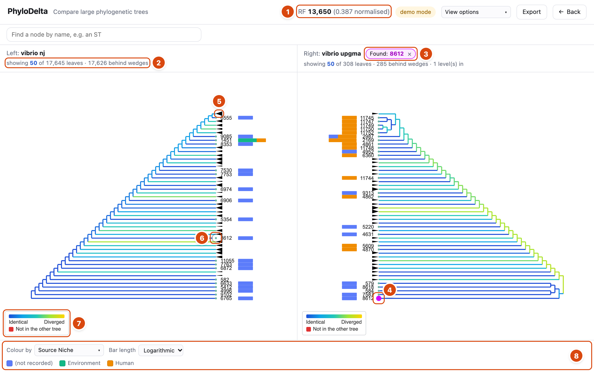

# Reading a comparison

What every colour, shape and number on the comparison screen means. For how to do things on the
screen, see [Using the web app](web-app-guide.md).

1. **The score** of the comparison ([The score](#the-score-top-bar)).
2. **How much is drawn**: leaves shown, of how many, and how many are folded into triangles ([The layout](#the-layout)).
3. **The found leaf**, named above the panel that marks it ([Marks](#marks)).
4. **The found leaf, marked** in magenta ([Marks](#marks)).
5. **A collapsed clade**: a triangle standing for a group of leaves ([Shapes](#shapes)).
6. **A leaf**, with its name ([Shapes](#shapes)).
7. **The colour legend**: blue identical, yellow most diverged, red not in the other tree ([Colours](#colours)).
8. **Isolate data**: what the bars beside the leaves are coloured by ([Isolate data bars](#isolate-data-bars)).

## The layout

- **Two panels.** The left tree is drawn root on the left, leaves on the right. The right tree is
  mirrored, root on the right, so the two trees face each other and corresponding groups sit
  opposite.
- **Only part of each tree is drawn.** Each panel shows as many leaves as fit on screen. Larger
  groups are folded into triangles. The header above each panel says how much is shown:
  **showing 50 of 17,646 leaves · 17,630 behind wedges · 2 level(s) in**:
  - *50 of 17,646*: 50 leaves or triangles drawn, standing for 17,646 leaves in the part of the tree
    on screen;
  - *behind wedges*: leaves folded into triangles;
  - *level(s) in*: how many clades deep you have opened (**Go back** goes out one).

## The score (top bar)

The top bar shows the comparison's headline score, e.g. **RF 13,650 (0.387 normalised)**. Hover over
it for its definition.

| Metric | Meaning |
|---|---|
| **RF** (Robinson-Foulds) | Number of clades in one tree with no identical clade in the other, counted in both directions. **0 = the trees have the same shape.** *Normalised* divides by the largest possible value: 0 identical, 1 nothing shared. |
| **Triplet** | Number of groups of three leaves that the two trees relate differently. Finer-grained than RF: it does not jump to "different" for a whole large clade because one leaf moved. |

A **yellow banner** under the top bar appears when the two trees' species were not declared, or
differ. Leaf names (sequence types) are numbered per species, so across species a matching name is a
coincidence and the comparison should be read with that in mind.

## Colours

The colour legend sits at the bottom left of each panel.

| You see | It means |
|---|---|
| **Blue** branch or triangle | **Identical**: this clade also exists in the other tree, with exactly the same leaves. |
| **Blue → cyan → green → yellow** | **Increasingly diverged**: the most similar clade in the other tree shares a smaller part of the leaves. Yellow is the least similar. |
| **Red** branch | **Not in the other tree**: a leaf present in only this tree, so it has no counterpart to compare with. |
| **Grey** branch | **Nothing to measure**: a single leaf always matches itself, so its score would be blue whatever the trees do. Grey says the colour has nothing to tell, rather than claim they agree. Under Triplet, clades of two leaves are grey too: they hold no group of three. |
| **Black** | No comparison colour on the branches: the trees are coloured by **Nothing** or by a leaf colouring such as MAST's **Kept or moved** (**View options → Colour the trees by**), or the colour has been moved to the triangles (**Colour the divergence on: Clades**). |

How the colour is computed: for each clade, PhyloDelta finds the clade in the other tree that shares
the most leaves with it, measured as *shared leaves ÷ leaves in either*. Identical clades score 1 and
are drawn blue; the lower the score, the further towards yellow.

## MAST (maximum agreement subtree)

A comparison is made by one metric, and is coloured only in the ways that metric offers. A
comparison by **MAST (maximum agreement subtree)** offers two. With **View options → Colour the trees by: Kept or
moved**, the colours describe **leaves**, not clades, and the legend changes to say so:

| You see | It means |
|---|---|
| **Blue** leaf | **In the agreement subtree**: one of the largest set of leaves both trees arrange in exactly the same way. |
| **Yellow** leaf | **Moved**: outside that set; the two trees place it differently. |
| **Red** leaf | **Not in the other tree**, as in the divergence colouring. |
| **Yellow** triangle | The collapsed clade holds at least one moved leaf. Hover for how many: "12 of 340 leaves: moved". |
| **Blue** triangle | None of its leaves moved. |

The top bar shows **Moved leaves N of M**. Three things to know when reading it:

- **It is strict.** The agreement subtree must agree *completely* in both trees, so trees built by
  different methods can share only a small one: on the demo's NJ and UPGMA trees, 2,909 of 17,645
  leaves (16%). Look at clades in detail, where most leaves can agree and one or two stand out.
- **It is not always unique.** When removing either of two leaves would make the trees agree equally
  well, one of them is chosen by a fixed rule. The *number* of moved leaves is exact; which of two
  interchangeable leaves is called moved is a choice.
- **It bounds the SPR distance.** Each moved leaf can be put back with one prune-and-regraft move, so
  the trees are at most that many such moves apart.

### Moved leaves on the branches

**View options → Colour the trees by: Share of each clade kept**, MAST's first colouring, uses the
same colour scale as Divergence, but scores each clade by MAST instead:

- **Blue:** all of its leaves are in the agreement subtree.
- **Yellow:** all of them moved.
- **In between:** the share kept.

**Find in the other tree** then goes to where the clade's kept leaves sit there. On the demo pair
most branches are yellow, for the reason above: the agreement subtree holds 16% of the leaves.

## Triplet distance

A comparison by **Triplet distance** colours each branch by its clade's own share of it:
**Triplets grouped alike**. Take every group of three leaves inside the clade; blue means both
trees group each of them the same way (which two are closer), yellow means none, and grey marks
a clade of one or two leaves, which holds no group of three to judge. The root's colour
is the whole comparison's, so the colours add up to the number in the top bar. Unlike Divergence,
a clade can keep exactly the same leaves in both trees and still be yellow: its leaves are all
there, but arranged differently inside it.

## SPR (subtree prune and regraft)

A comparison by **SPR (subtree prune and regraft)** counts the fewest moves, each cutting off a subtree and
reattaching it elsewhere, that turn one tree into the other. The top bar shows a **range**, such
as **SPR distance 1,905 to 5,653**: the exact number is only computable when it is small, and
otherwise the true value is known to lie between the two. When it is exact, one number is shown.

Its picture is an *agreement forest*: the trees cut into blocks of leaves that both arrange
identically, where every block but one is a move. Leaves that moved together share a block.

- **How intact each clade is** (branches): blue where all of a clade's leaves are in one block,
  yellow where each is in a block of its own; a single leaf, always one piece, is grey.
- **Largest block, moved together or moved alone** (leaves): blue for a leaf in the forest's
  largest block, teal for one moved together with others (its block has more than one leaf),
  yellow for one moved on its own, red for a leaf not in the other tree. Teal is what SPR adds
  over MAST: leaves that one move carried together. A triangle takes the colour of the furthest
  kind it holds, and its hover counts each.

## Shapes

| You see | It means |
|---|---|
| **Black triangle** | A **collapsed clade**: a group of leaves folded up to fit the screen. Its height is in proportion to the number of leaves it holds, against the largest triangle on screen (or by log₂ of the count, under **Wedge size → Logarithmic**); hover to see the count. Right-click → **Expand this clade** to open it. |
| **"N leaves"** beside triangles | Clade sizes, when **View options → Clade sizes** is on. |
| **Small dot with a name** | A **leaf**, with its name (in the demo trees, a sequence type). Not every name is printed when they would overlap; zoom in to see more. |
| **Light grey line to the tips** | *Phylogram only.* Branches end at their real length; the light line only carries the leaf across to the aligned column of names. It is layout, not distance. |
| **Small grey numbers on branches** | Branch lengths, when **View options → Branch lengths** is on. The real length, even on the logarithmic scale. Shown only where the branch is wide enough on screen; zoom in for more. |

## Marks

| You see | It means |
|---|---|
| **Magenta** leaf, blinking then steady | The leaf you searched for, or found with **Find this leaf in the other tree**. The header chip says **Found: …**. |
| **Magenta triangle** | The leaf is inside this triangle, which is too large to open at this level of detail. The chip says **Found inside: … (in this clade)**. |
| Chip says **(outside this view)** | The marked leaf is not in the part of the tree on screen. **Go back** to see it again. |
| **Orange** node | The node you clicked (selected). The header says **node … selected**. |
| **Message inside a panel** | Why that panel did not move, e.g. "211 is not in vibrio nj. This panel has not moved." Messages about missing leaves fade after a few seconds; errors stay until dismissed. |

## Isolate data bars

With **View options → Isolate data** on, each leaf carries a bar:

- **Length** = number of isolates with that sequence type (logarithmic by default, since some have
  hundreds and most a handful).
- **Colours** = the isolates split by the column chosen in **Colour by** (e.g. Source Niche). The
  legend at the bottom lists the colours; click a colour square to change it.
- **"(not recorded)"** = isolates with no value in that column.
- **No bar** = the leaf has no isolate data at all.
- Hover a bar for its counts, e.g. "1203: 14 isolates".
