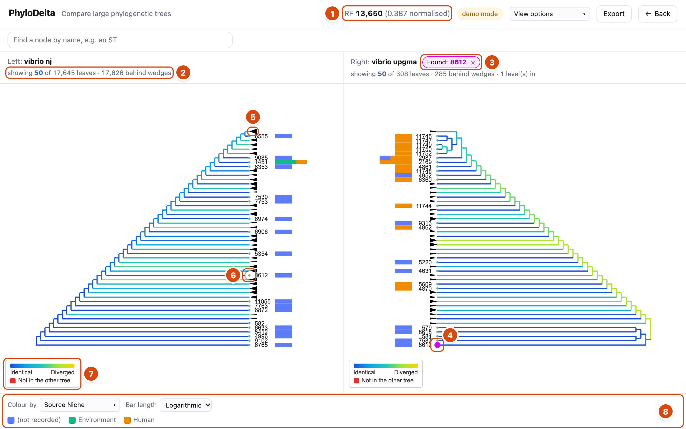

# Reading a comparison

What every colour, shape and number on the comparison screen means. For how to do things on the
screen, see [Using the web app](web-app-guide.md).

## The layout

- **Two panels.** The left tree is drawn root on the left, leaves on the right. The right tree is
  mirrored, root on the right, so the two trees face each other and corresponding groups sit
  opposite.
- **Only part of each tree is drawn.** Each panel shows as many leaves as fit on screen. Larger
  groups are folded into triangles. The header above each panel says how much is shown:
  **showing 50 of 17,646 leaves · 17,630 behind wedges · 2 level(s) in**:
  - *50 of 17,646*: 50 leaves or triangles drawn, standing for 17,646 leaves in the part of the tree
    on screen;
  - *behind wedges*: leaves folded into triangles;
  - *level(s) in*: how many clades deep you have opened (**Go back** goes out one).

## The score (top bar)

The top bar shows the comparison's headline score, e.g. **RF 13,650 (0.387 normalised)**. Hover over
it for its definition.

| Metric | Meaning |
|---|---|
| **RF** (Robinson-Foulds) | Number of clades in one tree with no identical clade in the other, counted in both directions. **0 = the trees have the same shape.** *Normalised* divides by the largest possible value: 0 identical, 1 nothing shared. |
| **Triplet** | Number of groups of three leaves that the two trees relate differently. Finer-grained than RF: it does not jump to "different" for a whole large clade because one leaf moved. |

A **yellow banner** under the top bar appears when the two trees' species were not declared, or
differ. Leaf names (sequence types) are numbered per species, so across species a matching name is a
coincidence and the comparison should be read with that in mind.

## Colours

The colour legend sits at the bottom left of each panel.

| You see | It means |
|---|---|
| **Blue** branch or triangle | **Identical**: this clade also exists in the other tree, with exactly the same leaves. |
| **Blue → cyan → green → yellow** | **Increasingly diverged**: the most similar clade in the other tree shares a smaller part of the leaves. Yellow is the least similar. |
| **Red** branch | **Not in the other tree**: a leaf present in only this tree, so it has no counterpart to compare with. |
| **Black** | No comparison colour: either divergence colouring is off (**View options → Divergence**), or the colour has been moved to the triangles (**Colour the divergence on: Clades**). |

How the colour is computed: for each clade, PhyloDelta finds the clade in the other tree that shares
the most leaves with it, measured as *shared leaves ÷ leaves in either*. Identical clades score 1 and
are drawn blue; the lower the score, the further towards yellow.

## Shapes

| You see | It means |
|---|---|
| **Black triangle** | A **collapsed clade**: a group of leaves folded up to fit the screen. Its height grows with the number of leaves it holds; hover to see the count. Right-click → **Expand this clade** to open it. |
| **"N leaves"** beside triangles | Clade sizes, when **View options → Clade sizes** is on. |
| **Small dot with a name** | A **leaf**, with its name (in the demo trees, a sequence type). Not every name is printed when they would overlap; zoom in to see more. |
| **Light grey line to the tips** | *Phylogram only.* Branches end at their real length; the light line only carries the leaf across to the aligned column of names. It is layout, not distance. |
| **Small grey numbers on branches** | Branch lengths, when **View options → Branch lengths** is on. The real length, even on the logarithmic scale. Shown only where the branch is wide enough on screen; zoom in for more. |

## Marks

| You see | It means |
|---|---|
| **Magenta** leaf, blinking then steady | The leaf you searched for, or found with **Find this leaf in the other tree**. The header chip says **Found: …**. |
| **Magenta triangle** | The leaf is inside this triangle, which is too large to open at this level of detail. The chip says **Found inside: … (in this clade)**. |
| Chip says **(outside this view)** | The marked leaf is not in the part of the tree on screen. **Go back** to see it again. |
| **Orange** node | The node you clicked (selected). The header says **node … selected**. |
| **Message inside a panel** | Why that panel did not move, e.g. "211 is not in vibrio nj. This panel has not moved." Messages about missing leaves fade after a few seconds; errors stay until dismissed. |

## Isolate data bars

With **View options → Isolate data** on, each leaf carries a bar:

- **Length** = number of isolates with that sequence type (logarithmic by default, since some have
  hundreds and most a handful).
- **Colours** = the isolates split by the column chosen in **Colour by** (e.g. Source Niche). The
  legend at the bottom lists the colours; click a colour square to change it.
- **"(not recorded)"** = isolates with no value in that column.
- **No bar** = the leaf has no isolate data at all.
- Hover a bar for its counts, e.g. "1203: 14 isolates".
